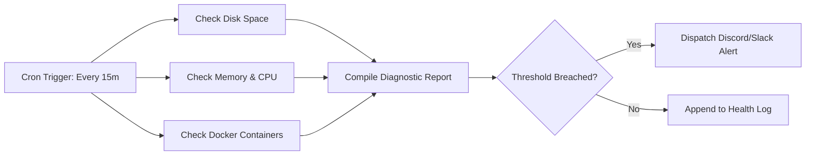
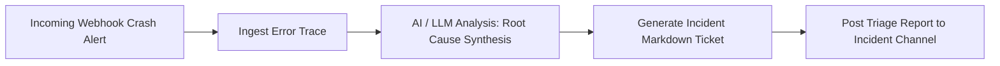
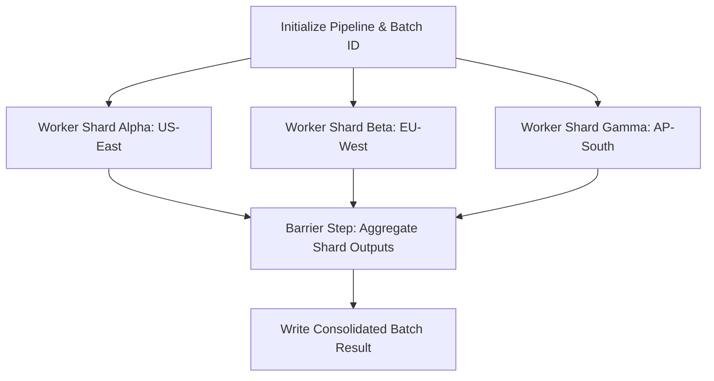

<div align="center">

```
  ╔═╗┬  ┌─┐┬ ┬╔═╗┌─┐┬─┐┌─┐┌─┐
  ╠╣ │  │ ││││╠╣ │ │├┬┘│ ┬├┤ 
  ╚  ┴─┘└─┘└┴┘╚  └─┘┴└─└─┘└─┘
```

# FlowForge 

### The Developer-First, Zero-Infrastructure Workflow Automation & Task Orchestration Engine for Python.

[](https://github.com/eyeblech/flowforge/actions)
[](https://www.python.org/)
[](LICENSE)
[](https://github.com/astral-sh/ruff)
[](https://docs.python.org/3/library/asyncio.html)
[](https://www.sqlite.org/wal.html)
[](https://github.com/eyeblech/flowforge/stargazers)

<p align="center">
  <a href="#-what-is-flowforge">What is FlowForge?</a> •
  <a href="#-real-world-use-cases">Use Cases</a> •
  <a href="#-how-to-run">How to Run</a> •
  <a href="#-workflow-anatomy">Workflow Syntax</a> •
  <a href="#-web-studio--api">Web Dashboard</a> •
  <a href="#-comparison">Comparison</a> •
  <a href="#-architecture">Architecture</a>
</p>

</div>

---

## What is FlowForge?

**FlowForge** is a modern, lightweight, async-native task orchestration and workflow automation engine. It allows developers to define multi-step Directed Acyclic Graph (DAG) pipelines in declarative YAML or Python, executing them with parallel task scheduling, automatic exponential-backoff retries, and microsecond SQLite state checkpointing.

### The Problem It Solves
Traditional workflow engines like **Apache Airflow** or **Temporal** are powerful, but they bring massive overhead:
- They require heavyweight distributed brokers (Redis, Kafka, RabbitMQ).
- They demand separate worker fleets, PostgreSQL clusters, and complex Kubernetes setups.
- Running a simple recurring server health watchdog or API ETL pipeline requires hundreds of megabytes of RAM and complex configuration.

### The FlowForge Solution
FlowForge brings the power of enterprise DAG scheduling into a **single, zero-infrastructure Python engine**:
- **Zero External Dependencies**: No Redis, RabbitMQ, or Celery required. Runs locally or in a single lightweight container.
- **Asyncio DAG Execution**: Computes topological sorting via Kahn's algorithm, detecting cycles and executing non-dependent steps concurrently.
- **Built-in Resilience**: Exponential backoff with randomized jitter, per-step execution timeouts, and conditional failure boundaries (`continue_on_error`).
- **SQLite WAL Checkpointing**: Every workflow run, step state, duration metric, and log entry is persisted instantly with zero external database configuration.
- **Dual Interface**: A rich terminal CLI with colored live progress trees **plus** an embedded Dark Mode Web Studio on `http://localhost:8000`.

---

## Real-World Use Cases

FlowForge is engineered for developers, sysadmins, and data engineers who need reliable automation without distributed cluster complexity.

### 1. 🛠 Autonomous DevOps & System Watchdogs
> *Continuously monitor server resources, evaluate thresholds, and trigger automated self-healing scripts or alerts.*


- **Example File**: [`examples/02_system_health_watchdog.yaml`](examples/02_system_health_watchdog.yaml)
- **Actions Used**: `shell`, `transform`, `file`, `notify`

---

### 2. 📊 Lightweight Data Engineering & API ETL
> *Extract records from REST endpoints, normalize nested JSON structures, and load directly into SQLite, Postgres, or Parquet.*


- **Example File**: [`examples/03_api_data_etl.yaml`](examples/03_api_data_etl.yaml)
- **Actions Used**: `http`, `sql`, `transform`

---

### 3. 🤖 AI-Powered Incident Triage & Diagnostics
> *Ingest production crash reports, use local LLMs (Ollama) or OpenAI to analyze tracebacks, extract root causes, and draft remediation tickets.*


- **Example File**: [`examples/04_ai_incident_summarizer.yaml`](examples/04_ai_incident_summarizer.yaml)
- **Actions Used**: `llm`, `shell`, `transform`, `file`

---

### 4. High-Throughput Parallel Batch Processing (Fan-Out / Fan-In)
> *Split large batch jobs across multiple concurrent shard workers, executing them in parallel and aggregating outputs at a barrier step.*


- **Example File**: [`examples/05_parallel_dag_fanout.yaml`](examples/05_parallel_dag_fanout.yaml)
- **Execution Speed**: 3 parallel branches take **~220ms total** instead of running sequentially.

---

### 5. Webhook Event Ingestion & Notification Router
> *Listen for incoming webhooks (GitHub pushes, Stripe payments, Datadog alerts), authenticate tokens, and route formatted alerts.*

- **Example File**: [`examples/06_webhook_pipeline.yaml`](examples/06_webhook_pipeline.yaml)
- **Actions Used**: `transform`, `file`, `notify`

---

## Feature Comparison Matrix

| Feature | **FlowForge** | **Apache Airflow** | **Temporal** | **Celery** |
|---|---|---|---|---|
| **Primary Focus** | Developer-first automation | Big Data / Enterprise ETL | Long-running state machines | Task queue worker pool |
| **External Broker Required** | ❌ **None** (Self-contained) | ✅ Redis / RabbitMQ | ✅ Custom cluster / DB | ✅ Redis / RabbitMQ |
| **Storage Engine** | ⚡ **Embedded SQLite WAL** | PostgreSQL / MySQL | PostgreSQL / Cassandra | Result Backend |
| **Language** | Modern Python 3.10+ | Python | Go / Java / Python / TS | Python |
| **Execution Model** | AsyncIO Parallel DAG | Multi-process Celery/K8s | Distributed Activity Workers | Worker processes |
| **Resource Footprint** | **~25 MB RAM** | ~1-2 GB+ RAM | ~500 MB+ RAM | ~100 MB+ RAM |
| **Web Dashboard** | Built-in Dark Mode UI | Heavyweight Webserver | Web UI service | Flower (separate) |
| **Startup Time** | **< 1 second** | Minutes | Minutes | Seconds |

---

## How to Run

You can run FlowForge in 4 flexible ways depending on your environment.

### 1. Installation

```bash
# Clone the repository
git clone https://github.com/eyeblech/flowforge.git
cd flowforge

# Setup virtual environment
python3 -m venv .venv
source .venv/bin/activate

# Install in editable mode
pip install -e .
```

---

### 2. Execution Modes

#### Option A: Terminal CLI (Fastest & Simplest)

Execute any workflow YAML directly with real-time colored step telemetry:

```bash
# Run the parallel fan-out workflow
flowforge run examples/05_parallel_dag_fanout.yaml

# Pass custom trigger parameters from the command line
flowforge run examples/01_github_release_monitor.yaml --param TARGET_REPO=pallets/flask

# Validate workflow DAG syntax and detect circular dependencies
flowforge validate examples/02_system_health_watchdog.yaml

# Render terminal dependency tree
flowforge tree examples/05_parallel_dag_fanout.yaml

# View recent runs stored in SQLite
flowforge runs list

# Inspect detailed step outputs and logs of a run
flowforge runs get <run_id>
```

**Terminal Run Preview:**
```
╭──────────────────────────────────────────────────────────────────────────────╮
│  ╔═╗┬  ┌─┐┬ ┬╔═╗┌─┐┬─┐┌─┐┌─┐                                                 │
│  ╠╣ │  │ ││││╠╣ │ │├┬┘│ ┬├┤                                                  │
│  ╚  ┴─┘└─┘└┴┘╚  └─┘┴└─└─┘└─┘                                                 │
│  Developer-first async workflow automation engine                            │
╰──────────────────────────────────────────────────────────────────────────────╯
Loaded workflow: Parallel DAG Fan-Out & Aggregation (6 steps)
Starting execution pipeline...
  ▶ Running step: init_pipeline
  ✔ Completed step: init_pipeline
  ▶ Running step: worker_shard_beta
  ▶ Running step: worker_shard_alpha
  ▶ Running step: worker_shard_gamma
  ✔ Completed step: worker_shard_beta
  ✔ Completed step: worker_shard_alpha
  ✔ Completed step: worker_shard_gamma
  ▶ Running step: aggregate_shards
  ✔ Completed step: aggregate_shards
  ▶ Running step: output_batch_summary
  ✔ Completed step: output_batch_summary

Execution Summary: Parallel DAG Fan-Out & Aggregation (run_ac2f4d07eeab)        
┏━━━━━━━━━━━━━━━━━┳━━━━━━━━━━━┳━━━━━━━━━━━┳━━━━━━━━━┳━━━━━━━━━━┳━━━━━━━━━━━━━━━┓
┃ Step ID         ┃ Action    ┃  Status   ┃ Attempt ┃ Duration ┃ Error / Notes ┃
┡━━━━━━━━━━━━━━━━━╇━━━━━━━━━━━╇━━━━━━━━━━━╇━━━━━━━━━╇━━━━━━━━━━╇━━━━━━━━━━━━━━━┩
│ init_pipeline   │ transform │ ● SUCCESS │    1    │    4.1ms │               │
│ worker_shard_b… │ shell     │ ● SUCCESS │    1    │  204.6ms │               │
│ worker_shard_a… │ shell     │ ● SUCCESS │    1    │  204.1ms │               │
│ worker_shard_g… │ shell     │ ● SUCCESS │    1    │  204.0ms │               │
│ aggregate_shar… │ transform │ ● SUCCESS │    1    │    4.7ms │               │
│ output_batch_s… │ file      │ ● SUCCESS │    1    │    2.2ms │               │
└─────────────────┴───────────┴───────────┴─────────┴──────────┴───────────────┘

╭─ Run Result ─────────────────────────────────────────────────────────────────╮
│ Status: ● SUCCESS  │  Total Duration: 223.80ms  │  Trigger: cli              │
╰──────────────────────────────────────────────────────────────────────────────╯
```

---

#### Option B: Embedded Web Dashboard & Webhook Server

Launch the self-hosted FlowForge Studio, REST API, and Trigger Server:

```bash
flowforge serve --workflows-dir ./examples --port 8000
```

1. Open your browser to **`http://localhost:8000`**.
2. View registered workflows, trigger runs with custom JSON payloads, and inspect step outputs.
3. Post incoming webhooks directly:
```bash
curl -X POST http://localhost:8000/api/v1/webhooks/webhook_pipeline \
  -H "Content-Type: application/json" \
  -H "X-FlowForge-Token: secret123" \
  -d '{"action": "deploy_completed", "sender": {"login": "octocat"}}'
```

---

#### Option C: 1-Click Docker Compose

Deploy a containerized FlowForge instance with persistent volumes:

```bash
docker compose up -d
```
Access the studio at `http://localhost:8000`.

---

#### Option D: Programmatic Python SDK

Use FlowForge directly inside your Python applications:

```python
import asyncio
from flowforge import WorkflowEngine, parse_workflow_str

workflow_yaml = """
id: programmatic_pipeline
name: Programmatic Pipeline
steps:
  - id: step_one
    action: transform
    with:
      value:
        greeting: "Hello from Python SDK!"
"""

async def main():
    engine = WorkflowEngine()
    workflow = parse_workflow_str(workflow_yaml)
    run = await engine.execute(workflow)
    print(f"Run completed with status: {run.status}")
    print(f"Output: {run.step_runs['step_one'].output_data}")

asyncio.run(main())
```

---

## 📖 Workflow Anatomy (YAML Specification)

Every workflow is defined in clear, human-readable YAML:

```yaml
# Unique workflow identifier and metadata
id: release_alert_pipeline
name: GitHub Release Alert Pipeline
version: "1.0"
description: Fetches latest releases and sends alerts

# Workflow-level environment variables
env:
  TARGET_REPO: "pallets/flask"

# Automated triggers (Cron, Webhook, FileWatch, Manual)
triggers:
  - type: cron
    config:
      expression: "0 */6 * * *"  # Runs every 6 hours
  - type: webhook
    config:
      secret_token: "secret123"

# Concurrency limits and global timeout
concurrency: 5
timeout: 300.0

# DAG Step definitions
steps:
  # Step 1: Make HTTP REST request with automatic retries
  - id: fetch_latest_release
    name: Fetch Latest Release
    action: http
    retry:
      max_attempts: 3
      initial_delay: 2.0
      backoff_multiplier: 2.0
      jitter: true
    with:
      url: "https://api.github.com/repos/{{ env.TARGET_REPO }}/releases/latest"
      expected_status: [200]

  # Step 2: Transform and extract specific JSON fields
  - id: extract_metadata
    name: Extract Release Metadata
    action: transform
    depends_on: [fetch_latest_release]
    with:
      value:
        tag: "{{ steps.fetch_latest_release.output.json.tag_name }}"
        author: "{{ steps.fetch_latest_release.output.json.author.login }}"

  # Step 3: Conditional execution (only runs if condition is True)
  - id: write_release_file
    name: Save Release Markdown
    action: file
    depends_on: [extract_metadata]
    when: "{{ steps.extract_metadata.output.tag != '' }}"
    with:
      operation: write
      path: "./output/releases/{{ steps.extract_metadata.output.tag }}.md"
      content: |
        # Release: {{ steps.extract_metadata.output.tag }}
        Author: @{{ steps.extract_metadata.output.author }}
```

---

## 🔌 Built-in Action Ecosystem

FlowForge includes rich built-in actions covering infrastructure, data, and AI:

| Action | Identifier | Description | Key Inputs |
|---|---|---|---|
| **HTTP Client** | `http` | Asynchronous REST API requests | `url`, `method`, `headers`, `json`, `expected_status` |
| **Shell Command** | `shell` | Async bash/terminal script execution | `command`, `cwd`, `env`, `fail_on_error`, `timeout` |
| **Data Transform** | `transform` | Dynamic JSON projection & list slicing | `value`, `items`, `limit`, `mapping` |
| **File System** | `file` | Read, write, append, delete, check files | `operation`, `path`, `content`, `encoding` |
| **SQL Database** | `sql` | Execute SQLite queries and fetch rows | `query`, `database`, `params`, `fetch` |
| **Notifications** | `notify` | Dispatch Slack/Discord webhook cards | `webhook_url`, `channel`, `title`, `message`, `level` |
| **AI / LLM Node** | `llm` | AI decision and extraction via OpenAI/Ollama | `prompt`, `model`, `system`, `temperature`, `json_mode` |
| **Delay / Sleep** | `delay` | Timed pauses and rate limiting | `seconds` |

### Creating Custom Actions

Writing custom actions requires just a single Python class:

```python
from flowforge.actions.base import BaseAction, ActionResult, ActionContext, register_action
from typing import Dict, Any

@register_action("send_sms")
class SendSmsAction(BaseAction):
    name = "send_sms"

    async def execute(self, params: Dict[str, Any], context: ActionContext) -> ActionResult:
        recipient = params.get("to")
        message = params.get("message")
        # Call your SMS provider API here...
        return ActionResult(success=True, output={"delivered": True, "to": recipient})
```

---

## 🏗 Architecture & Internal Design

FlowForge separates concerns into clean, decoupled layers:

```
                    ┌────────────────────────────┐
                    │      Trigger Layer         │
                    │  (CLI, Webhook, Cron, Watch)│
                    └─────────────┬──────────────┘
                                  │
                                  ▼
                    ┌────────────────────────────┐
                    │      Workflow Parser       │
                    │   (YAML/JSON Validation)   │
                    └─────────────┬──────────────┘
                                  │
                                  ▼
                    ┌────────────────────────────┐
                    │        DAG Engine          │
                    │  (Kahn's Cycle Detection)  │
                    └─────────────┬──────────────┘
                                  │
                                  ▼
      ┌────────────────────────────────────────────────────────┐
      │               Async Workflow Engine                     │
      │                                                        │
      │  ┌───────────────────┐        ┌─────────────────────┐  │
      │  │ Step Scheduler    │        │ Semaphore           │  │
      │  │ (Parallel Tasks)  │◄──────►│ (Concurrency Cap)   │  │
      │  └─────────┬─────────┘        └─────────────────────┘  │
      │            │                                           │
      │            ▼                                           │
      │  ┌───────────────────┐        ┌─────────────────────┐  │
      │  │ Expression Engine │        │ Action Registry     │  │
      │  │ (Jinja2 Templates)│◄──────►│ (HTTP, Shell, File, │  │
      │  └─────────┬─────────┘        │  SQL, Notify, LLM)  │  │
      │            │                  └─────────────────────┘  │
      │            ▼                                           │
      │  ┌───────────────────┐                                 │
      │  │ Retry Policy Loop │                                 │
      │  │ (Exponential+Jitter)                                │
      │  └───────────────────┘                                 │
      └───────────────────────────┬────────────────────────────┘
                                  │
                 ┌────────────────┴────────────────┐
                 ▼                                 ▼
    ┌──────────────────────────┐     ┌───────────────────────────┐
    │   SQLite WAL Storage     │     │       Event Bus           │
    │  (Runs, Steps, Telemetry)│     │  (CLI Live TUI & Server)  │
    └──────────────────────────┘     └───────────────────────────┘
```

1. **Topological Sorting**: Before execution begins, `WorkflowGraph` runs Kahn's algorithm to verify the DAG is acyclic and compute dependency chains.
2. **Parallel Scheduling**: Tasks with zero unfinished prerequisites are scheduled as concurrent `asyncio.Task` instances bounded by a configurable `asyncio.Semaphore`.
3. **Expression Interpolation**: The context maintains step outputs dynamically. When Step B runs, it can reference `{{ steps.step_a.output.some_field }}` with full type preservation.
4. **State Persistence**: The SQLite storage layer records initial run creation, step transitions (`PENDING` ➔ `RUNNING` ➔ `SUCCESS`/`FAILED`/`SKIPPED`), execution duration, and errors.

---

## 🧪 Testing Suite

FlowForge maintains 100% test pass fidelity across models, expressions, DAG cycle detection, storage, runner retries, REST endpoints, and CLI commands.

```bash
# Run pytest with async support
pytest -v
```

```
============================== test session starts ==============================
collected 48 items

tests/test_actions.py ......                                             [ 12%]
tests/test_cli.py ......                                                 [ 25%]
tests/test_expression.py .....                                           [ 35%]
tests/test_graph.py .....                                                [ 45%]
tests/test_models.py ......                                              [ 58%]
tests/test_parser.py ....                                                [ 66%]
tests/test_runner.py ......                                              [ 79%]
tests/test_server.py ......                                              [ 91%]
tests/test_storage.py ....                                               [100%]

======================== 48 passed, 0 warnings in 0.67s ========================
```

---

